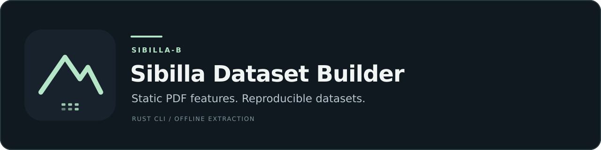
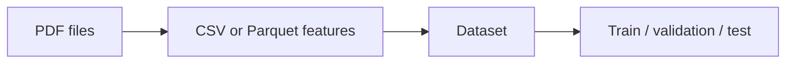

<a href="https://github.com/younidev-org/sibilla-dataset-builder"></a>

<div align="center">

  <p align="center">
    <a href="https://www.kernel.org/"></a>
    <a href="https://www.rust-lang.org/"></a>
    <a href="https://github.com/younidev-org/sibilla-dataset-builder/releases"></a>
    <a href="LICENSE"></a>
    <a href="docs/README.md"></a>
  </p>

  <p>A Rust CLI for extracting static PDF features and assembling reproducible datasets.</p>

  <p align="center">
    <a href="#features">Features</a> •
    <a href="#showcase">Showcase</a> •
    <a href="#quick-start">Quick Start</a> •
    <a href="#development">Development</a> •
    <a href="#guides">Guides</a>
  </p>
</div>

---

## Features

- 🔎 Extract static features from a PDF or a folder of PDFs.
- 📊 Save features as CSV or Parquet, with explicit nulls for unavailable values.
- ♻️ Resume interrupted runs without repeating validated records.
- 🧬 Combine labeled tables, remove exact duplicates, and create train/validation/test splits.
- 🎛️ Use progress bars, optional colors, short flags, or quiet output for scripts.
- 🧪 Try generated safe PDFs or measure throughput on your own corpus.



> [!CAUTION]
> Use a dedicated VM/container for untrusted files. The tool never executes or renders PDFs, but its worker restrictions are not complete isolation.

<details>
<summary><strong>Before using the results</strong></summary>

- `pdf-v2` is still in development; unsupported measurements remain null.
- Temporal evaluation and million-file external sorting are not available.
- Related files need meaningful grouping to avoid leakage between splits.
- Peak memory and storage type are not measured automatically by benchmarks.
- Parser-internal decompression is limited per stream and by worker memory; it does not have a complete aggregate accounting limit.

See [feature meanings](docs/FEATURE_SCHEMA.md), [dataset rules](docs/DATASET_PROTOCOL.md), and [security limits](SECURITY.md).

</details>

## Showcase

See [safe demonstration](docs/USAGE.md#safe-demonstration) generates three one-page PDFs and builds a grouped dataset from them.

## Quick start

Use `sibilla-b` on Linux 5.6+ (x86-64 or AArch64). See [releases](docs/RELEASES.md) for packaged binaries or [Development](#development) to build from source.

If you built locally, replace `sibilla-b` below with `target/release/sibilla-b`.

### 1. Extract your PDFs

```sh
sibilla-b extract pdf -i ./samples/benign --type benign -o ./features/benign.parquet
sibilla-b extract pdf -i ./samples/malicious --type malicious -o ./features/malicious.csv
```

Supply the labels yourself. Input files are read-only; output paths must be new.

### 2. Build a dataset

```sh
sibilla-b dataset build -i ./features/benign.parquet -i ./features/malicious.csv \
  -o ./datasets/pdf-v1 --split 70:15:15 --seed 42
```

Open `./datasets/pdf-v1/report.json` to check counts and exclusions. Use `--group-column` when your tables contain meaningful related-file groups.

### 3. Inspect the result

```sh
sibilla-b inspect ./features/benign.parquet
sibilla-b inspect ./features/benign.parquet --columns
sibilla-b inspect ./features/benign.parquet --json
```

Inspection reads every row, reporting labels, statuses, error reasons, missing values, and up to five sample errors. `--columns` maps shorter display names to the unchanged exported names.

### 4. Adjust a run

| I want to… | Add this option |
| --- | --- |
| Use four workers | `-j 4` on `extract pdf` |
| Resume an interrupted extraction | `--resume`, keeping the original input and output arguments |
| Turn colors off | `--no-color` or `--color never` |
| Hide progress and status | `--quiet` |
| Save failed or partial records | `--failures failures.jsonl` |
| Read command help | `--help` |

Start with the [safe demonstration](docs/USAGE.md#safe-demonstration) if you have no PDFs ready. The private `.fixtures` corpus is not required.

## Development

Building from source requires Rust 1.88+ and Cargo. Run commands from the repository root.

| Need | Command |
| --- | --- |
| Build the CLI | `cargo build --release --locked` |
| Install the test runner | `cargo install cargo-nextest --locked` |
| Run tests | `cargo nextest run --workspace --all-targets --locked` |
| Check formatting | `cargo fmt --all --check` |
| Run Clippy | `cargo clippy --workspace --all-targets --locked -- -D warnings` |
| Generate safe fixtures | `cargo run -p sibilla-b-pdf --example generate_fixtures -- .local/demo/samples` |

## Guides

Choose a guide by task, or browse the complete [documentation hub](docs/README.md):

| I want to… | Start here |
| --- | --- |
| Extract PDFs, resume, or try sample commands | [CLI usage](docs/USAGE.md) |
| Combine tables and create reliable splits | [Build a dataset](docs/DATASET_PROTOCOL.md) |
| Understand missing values and output columns | [Read the feature table](docs/FEATURE_SCHEMA.md) |
| Handle untrusted PDFs safely | [Security](SECURITY.md) |
| Use a packaged executable | [Releases](docs/RELEASES.md) |

## Tech stack

<p align="left">
  <a href="https://www.rust-lang.org/"></a>
  <a href="https://www.kernel.org/"></a>
  <a href="https://docs.rs/clap/4.6.7/clap/"></a>
  <a href="https://docs.rs/lopdf/0.46.0/lopdf/"></a>
  <a href="https://arrow.apache.org/"></a>
  <a href="https://parquet.apache.org/"></a>
  <a href="https://docs.rs/indicatif/0.18.6/indicatif/"></a>
  <a href="https://nexte.st/"></a>
</p>

---

## License

Distributed under the [BSD 3-Clause License](LICENSE).
