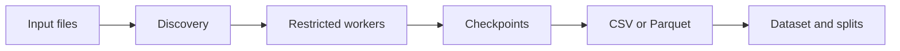

  

    
    
    
    
    
  

  
An offline Rust CLI for extracting static PDF features and assembling reproducible datasets.

  

    <a href="#features">Features</a> •
    <a href="#showcase">Showcase</a> •
    <a href="#quick-start">Quick Start</a> •
    <a href="#development">Development</a> •
    <a href="#guides">Guides</a>
  

---

## Features

- 🔎 **Static PDF features:** byte statistics, 256 histogram columns, structural measurements, and separate raw-token and parsed-name counts.
- ⚙️ **Supervised parsing:** reusable worker processes with timeouts, CPU and memory limits, and Linux network restrictions.
- 📊 **Typed output:** CSV and Parquet tables with explicit nulls, quality metadata, and optional JSONL failure sidecars.
- ♻️ **Validated resume:** source-hash checks, synchronized checkpoints, atomic publication, and refusal to overwrite existing outputs.
- 🧬 **Dataset construction:** exact deduplication, label-conflict handling, reproducible group-aware splits, manifests, reports, and artifact hashes.
- 🎛️ **Terminal controls:** colored help, progress bars, short options, quiet mode, and clean machine-readable stdout.
- 🧪 **Safe development:** generated nonmalicious fixtures, nextest checks, and real extraction benchmarks.

> [!CAUTION]
> This is a development implementation: `pdf-v1` is not frozen. Worker restrictions are not full filesystem or kernel isolation; use a dedicated VM/container for untrusted inputs. The tool never executes samples, renders PDFs, contacts URLs, or trains models.

<strong>Current limitations</strong>

- Temporal evaluation is rejected because the schema has no defensible first-seen timestamps.
- The full specified PDF feature schema is unfinished; unsupported measurements remain null.
- Discovery paths and identity/group metadata remain in memory. Feature rows spool to disk, but million-file scaling and external sorting are unfinished.
- Worker memory, CPU, descriptor, and network controls do not provide complete isolation.
- Explicit stream measurements share an aggregate decode budget; parser-internal expansion is limited per stream and by process memory. Stronger sandbox and aggregate parser accounting remain unfinished.
- Benchmarks cover complete extraction; peak memory and storage type are not automatically measured and must be recorded separately.

## Showcase

No runtime screenshots are included; the [safe demonstration](docs/USAGE.md#safe-demonstration) generates three one-page PDFs and builds a grouped dataset from them.

## Quick start

The executable is `target/release/sibilla-b`. Provide your own input files; labels are supplied explicitly and never inferred. The optional private `.fixtures` corpus is not required by CI.

### Configuration overview

| Area | Configure | Available options |
| --- | --- | --- |
| Labels | `--type` | `benign`, `malicious`, `unknown` → `0`, `1`, null |
| Output | `--output`, `--format` | CSV or Parquet; explicit format overrides the extension |
| Traversal | `--no-recursive`, `--follow-symlinks` | Recursive by default; symlink following is opt-in |
| Terminal | `--color`, `--no-color`, `--quiet` | Color defaults to `always`; `auto` and `never` are available |

Files are opened read-only and existing outputs are refused. Symlink following can include files outside the input tree. See the [usage guide](docs/USAGE.md) for dataset commands, checkpoint behavior, failure handling, and the synthetic demonstration.

## Development

Install nextest if needed with `cargo install cargo-nextest --locked`.

| Need | Command |
| --- | --- |
| Run tests | `cargo nextest run --workspace --all-targets --locked` |
| Check formatting | `cargo fmt --all --check` |
| Run Clippy | `cargo clippy --workspace --all-targets --locked -- -D warnings` |
| Build the CLI | `cargo build --release --locked` |
| Generate safe fixtures | `cargo run -p sibilla-b-pdf --example generate_fixtures -- .local/demo/samples` |

Normal CI runs only on pushes to `main`. Version tags trigger qualification and a draft release; the tag must match the workspace version and `main` HEAD. See [CI and releases](docs/RELEASES.md) for checks, archives, checksums, and publication policy.

## Guides

Choose a guide by task, or browse the complete [documentation hub](docs/README.md):

| I want to… | Start here |
| --- | --- |
| Extract features, resume a run, or try the safe demo | [CLI usage](docs/USAGE.md) |
| Understand columns, nulls, and measurement limits | [Feature schema](docs/FEATURE_SCHEMA.md) |
| Build datasets and avoid split leakage | [Dataset protocol](docs/DATASET_PROTOCOL.md) |
| Understand worker and storage boundaries | [Architecture](docs/ARCHITECTURE.md) |
| Review input handling and isolation limits | [Security](SECURITY.md) |
| Understand CI and draft releases | [CI and releases](docs/RELEASES.md) |

## Tech stack

  
  
  
  
  
  
  
  

---

## License

Distributed under the [BSD 3-Clause License](LICENSE).
